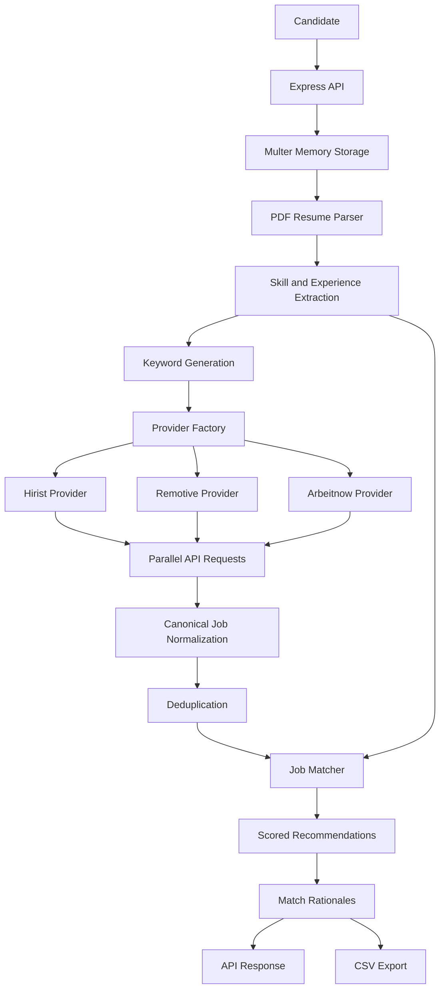

# AutoApply.AI — Intelligent Job Matching & Recommendation Engine

An API-driven job discovery and recommendation engine that parses PDF resumes, discovers relevant job opportunities across multiple platforms, and ranks them using skill alignment, experience tolerance, and explainable scoring — with **ephemeral, in-memory resume processing**.

---

## Overview

AutoApply.AI helps candidates discover relevant job opportunities without manually searching multiple job portals. Upload a resume, select job sources, and receive ranked recommendations with transparent explanations of why each role matches your skills and experience.

The project evolved from browser-based scraping to a lightweight HTTP/API-driven architecture designed to reduce latency, resource consumption, and dependence on browser automation.

---

## Demo

https://github.com/user-attachments/assets/e26e347e-0136-451e-a479-0cce56eb30ae

---
### Key Highlights

- **Multi-source job discovery** across Hirist, Remotive, and Arbeitnow.
- **In-memory PDF processing** using Multer and `pdf-parse`, without intentionally persisting resume data to disk.
- **Automated skill extraction and experience estimation** from resume content.
- **Parallel API ingestion** using `Promise.allSettled()` for resilient multi-keyword searches.
- **Explainable job matching** with weighted skill coverage, experience tolerance, and human-readable rationales.
- **Canonical job normalization** through a provider-adapter architecture.
- **Duplicate elimination** across overlapping keyword searches.
- **CSV export** using an RFC 4180-compliant export implementation.
- **Type-safe architecture** built with TypeScript and Express.

---

## Table of Contents

- [Architecture](#architecture)
- [Core Features](#core-features)
- [Job Matching Algorithm](#job-matching-algorithm)
- [Supported Job Providers](#supported-job-providers)
- [Request Lifecycle](#request-lifecycle)
- [Project Structure](#project-structure)
- [Technology Stack](#technology-stack)
- [Getting Started](#getting-started)
- [API Reference](#api-reference)
- [Privacy and Data Handling](#privacy-and-data-handling)
- [Engineering Challenges](#engineering-challenges)
- [Limitations and Future Improvements](#limitations-and-future-improvements)
- [License](#license)

---

## Architecture

AutoApply.AI follows a modular, provider-based architecture that separates data ingestion, resume processing, job normalization, matching, and export functionality.



### Architectural Principles

**1. Separation of concerns**

Each subsystem has a clearly defined responsibility. Providers handle external data sources, the resume parser extracts candidate information, and the matcher evaluates job relevance independently of any specific portal.

**2. Provider abstraction**

All job sources conform to a shared interface, allowing new providers to be added without coupling the matching algorithm to provider-specific response formats.

**3. Parallel ingestion**

Multiple skill-based queries are executed concurrently. `Promise.allSettled()` allows the system to process successful provider responses even when individual requests fail.

**4. Ephemeral candidate processing**

Resume uploads are handled using in-memory buffers rather than intentional local-file persistence. Candidate data is processed within the active request workflow.

**5. Explainable recommendations**

Instead of relying exclusively on a percentage score, the engine generates rationales describing relevant skills, missing requirements, and the factors affecting each recommendation.

---

## Core Features

### 1. PDF Resume Parsing

The resume-processing pipeline extracts text from uploaded PDF documents directly from a memory buffer.

**Implementation details:**

- `multer.memoryStorage()` for multipart file ingestion.
- `req.file.buffer` as the in-memory PDF representation.
- `pdf-parse` v2.x using the `PDFParse` class API.
- Text normalization and token extraction for downstream matching.
- Experience estimation from explicit tenure statements and employment date ranges.
- Student, internship, and fresher indicators to help calibrate experience estimates.

The resulting candidate profile supplies the skills and experience information used to discover and rank jobs.

### 2. Automated Skill Extraction

The extracted skills are used to generate multiple search queries instead of relying on a single keyword.

For candidates with limited experience, the query-generation process can include entry-level terms such as `Junior` to broaden the search toward relevant early-career positions.

Skill normalization handles common variations such as:

| Original values | Normalized matching intent |
|---|---|
| `React`, `React.js` | React |
| `full stack`, `fullstack` | Full Stack |
| `Node.js`, `Nodejs` | Node.js |
| `Java-Script`, `JavaScript` | JavaScript |

Normalization also removes selected formatting differences, including spaces, hyphens, and periods, to improve matching consistency.

The engine can infer Full Stack alignment when both frontend and backend skills are detected.

### 3. Multi-Source Job Discovery

The Provider Factory dispatches requests to one or more configured job providers.

Supported selection modes include individual sources and an `all` mode for querying all configured providers.

### 4. Deduplication

Overlapping keyword searches can return the same job multiple times.

AutoApply.AI removes duplicates using a composite key:

```typescript
const key = `${sourcePortal}-${id}`;
```

Including the source identifier prevents listings from different portals from being incorrectly treated as identical merely because their IDs coincide.

### 5. Explainable Job Recommendations

Every evaluated job can include a score and a human-readable rationale.

The explanation highlights matching skills, relevant requirements, and missing skills where that information is available.

### 6. CSV Export

Matched jobs can be exported through a dedicated CSV streaming subsystem designed around RFC 4180 formatting conventions.

This makes recommendations easier to review, filter, and manage in spreadsheet applications.

---

## Job Matching Algorithm

The matching engine combines skill coverage, role alignment, and experience compatibility to rank discovered opportunities.

### Weighted Skill Coverage

The current scoring design allocates:

| Component | Weight |
|---|---:|
| Mandatory skill coverage | 70% |
| Optional skill/tag coverage | 30% |

Mandatory requirements receive greater weight because they are more indicative of whether a candidate satisfies the role's core technical expectations.

The score is not intended to represent a statistically calibrated probability of receiving an interview.

### Zero-Match Circuit Breaker

A critical problem emerged when jobs without explicit mandatory tags received an artificially high score because the mandatory component defaulted to 70%.

This allowed irrelevant roles, such as freelance writing positions, to rank highly for technical candidates.

The solution was an explicit zero-match rule:

```typescript
if (matchedSkills.length === 0) {
    score = 0;
}
```

The matcher also uses fallback scanning of raw job descriptions to recover relevant skills when structured tags are missing or incomplete.

### Role Alignment Penalty

Non-technical roles receive a 60% penalty under the current design.

This reduces the likelihood of unrelated positions appearing prominently in recommendations.

### Experience Tolerance

The matcher supports three experience-filtering modes:

| Mode | Purpose |
|---|---|
| `strict` | Prioritizes roles that closely satisfy experience requirements. |
| `moderate` | Allows some flexibility, including entry-level candidates applying to roles requiring up to three years of experience. |
| `any` | Broadens experience eligibility to include otherwise excluded opportunities. |

These modes help prevent strict experience filtering from eliminating every opportunity for freshers and junior candidates.

### Match Rationales

Recommendations explain why a job was selected, including relevant skills and missing requirements when identifiable.

This makes the matching process easier to inspect and improves the usefulness of recommendations beyond a standalone percentage.

---

## Supported Job Providers

| Provider | Integration approach | Data normalization considerations |
|---|---|---|
| **Hirist** | HTTP/API integration | Numeric salary ranges, structured tags, and experience requirements |
| **Remotive** | Developer API | HTML job descriptions and unstructured skill tags |
| **Arbeitnow** | Developer API | Markdown descriptions, location strings, and job metadata |

The adapters convert provider-specific responses into a common `StandardJob` representation.

### Provider Interface

The architecture uses:

- `IJobProvider` — the shared provider contract.
- `BaseJobProvider` — common provider functionality.
- `ProviderFactory` — provider selection and dispatch.
- `StandardJob` — the canonical job representation consumed by the matcher.

This abstraction allows the matching engine to remain independent of the source platform's response schema.

**Note:** API availability, authentication requirements, usage limits, and permitted access depend on each provider. Internal or reverse-engineered endpoints may change without notice.

---

## Request Lifecycle

A typical request follows these steps:

1. The candidate submits a PDF resume and selects the desired job sources.
2. Multer receives the file into memory.
3. The PDF parser extracts the resume text.
4. The resume parser identifies relevant skills and estimates experience.
5. The server generates multiple search keywords.
6. The Provider Factory dispatches concurrent API requests.
7. Provider adapters normalize successful responses into `StandardJob` objects.
8. A composite-key map removes duplicate listings.
9. The matching engine scores jobs against the candidate profile.
10. The engine generates match rationales and returns recommendations.
11. The results can be exported as CSV.

Individual provider failures can be isolated so that one unsuccessful request does not necessarily invalidate the entire discovery process.

---

## Project Structure

```text
src/
├── types/
│   └── ...                 # StandardJob, UserProfile, IJobProvider
├── services/
│   ├── http/
│   │   └── ...             # ApiClient and request serialization
│   ├── resume/
│   │   └── ...             # PDF, skill, and experience parsing
│   ├── providers/
│   │   └── ...             # Provider adapters and ProviderFactory
│   ├── matcher/
│   │   └── ...             # Scoring, filtering, and rationales
│   └── export/
│       └── ...             # RFC 4180-compliant CSV export
├── controllers/
│   └── ...                 # Request orchestration
├── routes/
│   └── ...                 # API route definitions
└── server.ts               # Express application and static hosting
```

The tree illustrates the logical module organization. Individual filenames and tests can be documented as the repository evolves.

---

## Technology Stack

| Technology | Purpose |
|---|---|
| TypeScript | Type-safe application logic and provider contracts |
| Node.js | Server-side JavaScript runtime |
| Express.js | HTTP server and request handling |
| Multer | Multipart PDF uploads |
| `pdf-parse` v2.x | PDF text extraction |
| HTTP client / API integrations | External job ingestion |
| `Promise.allSettled()` | Resilient parallel request orchestration |
| Playwright | Used during the initial browser-automation prototype |
| CSV streaming | Exporting job recommendations |

---

## Getting Started

### Prerequisites

- A supported Node.js installation.
- npm or the package manager specified by the repository.
- Network access to the configured job-provider APIs.
- Provider credentials or configuration where required.

### Installation

Clone the repository:

```bash
git clone <YOUR_REPOSITORY_URL>
cd <YOUR_PROJECT_DIRECTORY>
```

Install dependencies:

```bash
npm install
```

Configure any provider credentials or environment variables required by the implementation.

Start the application using the development or production script defined in `package.json`.

```bash
npm run dev
```

The command above assumes the repository defines a `dev` script. If it does not, use the appropriate script from `package.json`.

### Configuration

Add an `.env.example` file documenting the environment variables actually consumed by the application.

Keep secrets in a local `.env` file or deployment secret manager, and ensure `.env` is excluded from version control.

**Important:** The exact environment variables, startup scripts, request payload, and response schema should be documented from the current implementation rather than assumed.

---

## API Reference

### `POST /api/match-jobs`

The primary matching endpoint accepts a resume upload and returns relevant job recommendations.

**Expected responsibilities:**

- Accept multipart form data.
- Validate the uploaded PDF.
- Parse candidate skills and experience.
- Select the requested provider or providers.
- Fetch, normalize, and deduplicate job listings.
- Score jobs and generate explanations.
- Return matching results.

The exact multipart field names, provider-selection parameter, response structure, and error codes depend on the current controller and route implementation.

A complete API reference should include a real request example and representative response from the running application.

---

## Privacy and Data Handling

AutoApply.AI is designed around ephemeral resume processing.

The intended data flow avoids deliberately saving candidate resumes, extracted profiles, or tracking data to local files or a database.

### Current design

- PDF uploads are stored in memory using `multer.memoryStorage()`.
- Resume text and extracted profile data are processed in the active application workflow.
- The architecture does not require a database for candidate resume persistence.
- Temporary files are not required for the described PDF parsing pipeline.

### Important implementation caveats

In-memory processing is not, by itself, a guarantee that all candidate data is immediately erased.

JavaScript garbage collection is nondeterministic. Data may remain in memory until reclaimed, and copies can exist in logs, exception reports, monitoring systems, or other application components if they are introduced.

A production deployment should also verify request logging, reverse-proxy behavior, error reporting, response caching, and infrastructure-level retention policies.

---

## Engineering Challenges

The project involved several practical engineering problems and corresponding architectural improvements.

| Challenge | Root cause | Resolution |
|---|---|---|
| Browser automation timeouts | Fragile DOM selectors and insufficient wait times | Corrected selectors and improved timeout handling |
| Cloudflare challenge loops | Browser automation exposed to anti-bot checks | Pivoted toward API-driven ingestion |
| Missing Node.js globals in TypeScript | Incomplete compiler and type configuration | Configured `tsconfig.json` and Node.js type definitions |
| `pdf-parse` runtime errors | Breaking API changes in v2.x | Migrated to the `PDFParse` class API |
| PowerShell cURL incompatibility | `curl` alias and shell-specific syntax | Used `curl.exe` and PowerShell line continuations |
| Empty Hirist search results | Restrictive query parameters | Simplified search parameters and encoding |
| No results for freshers | Strict experience filtering | Added `strict`, `moderate`, and `any` tolerance modes |
| Skill alias mismatches | Rigid string comparison | Added normalization and compound-skill inference |
| TypeScript `Map` overload errors | Incorrect generic inference | Explicitly typed the provider map |
| Irrelevant jobs receiving high scores | Default mandatory-score behavior | Added a zero-match circuit breaker |
| Undefined tag errors | Inconsistent provider response data | Added input validation and tag sanitization |

These issues informed the current separation between provider-specific ingestion and a shared matching engine.

---

## Limitations and Future Improvements

Potential next steps include:

- [ ] Add comprehensive unit and integration tests for resume parsing and scoring.
- [ ] Add provider-specific timeout, retry, and rate-limit policies.
- [ ] Validate and document the complete API contract.
- [ ] Improve skill extraction using a maintained skill taxonomy and alias dictionary.
- [ ] Evaluate ranking quality against manually reviewed candidate-job pairs.
- [ ] Add configurable weights and explainable score breakdowns.
- [ ] Improve extraction of salary, location, remote status, and employment type.
- [ ] Add containerization and deployment configuration.
- [ ] Introduce structured operational metrics without logging sensitive resume content.
- [ ] Audit privacy, upload limits, file validation, and error-handling paths.
- [ ] Verify provider API permissions, terms, and long-term endpoint stability.

---

## License

Add the license appropriate for this repository. If you intend to make the project open source, consider including a `LICENSE` file and specifying the chosen license here.

---

**AutoApply.AI** — Making job discovery more targeted, transparent, and efficient.
