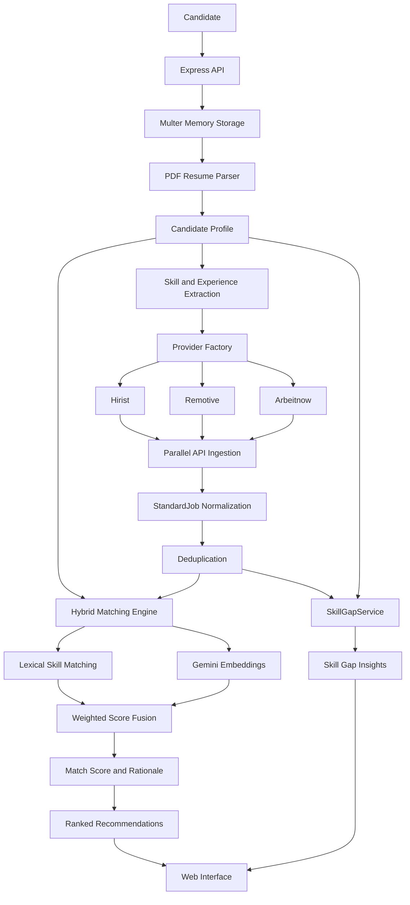

# AutoApply.AI — AI-Powered Job Matching & Skill Gap Analytics

An intelligent job discovery and recommendation engine that combines **Google Gemini embeddings, lexical skill matching, and explainable ranking** to connect candidates with relevant opportunities. Upload a PDF resume, discover jobs across multiple providers, understand why each role matches, and identify high-value skills to learn next.

AutoApply.AI combines semantic search, real-time job ingestion, and resume-driven analytics in a privacy-conscious architecture designed around in-memory candidate processing.

## Overview

Traditional job searches rely heavily on keyword matching, making it difficult to identify opportunities described using different terminology or contextual variations. AutoApply.AI addresses this limitation through a hybrid matching engine that combines lexical overlap with semantic similarity.

The platform parses a candidate's resume, fetches opportunities from multiple job providers, normalizes job data, and ranks recommendations using both explicit skill matches and contextual relevance.

Beyond job recommendations, AutoApply.AI analyzes the fetched listings to identify missing technologies that could improve a candidate's alignment with the available job market.

### Key Features

- **Hybrid AI matching:** Combines 45% keyword overlap with 55% semantic similarity using Google's `gemini-embedding-001`.
- **Explainable recommendations:** Displays transparent score breakdowns, match badges, and tailored rationales on job cards.
- **Multi-source discovery:** Integrates Hirist, Remotive, and Arbeitnow through provider adapters.
- **Automated resume analysis:** Extracts skills and estimates experience from uploaded PDF resumes.
- **Skill Gap Analytics:** Identifies technologies missing from the applicant's profile based on fetched job postings.
- **Parallel ingestion:** Executes multiple keyword searches concurrently and deduplicates results.
- **Resilient matching:** Falls back to lexical heuristics when semantic embedding generation is unavailable.
- **Ephemeral resume processing:** Uses in-memory PDF buffers rather than intentionally persisting uploaded resumes to disk.
- **Custom visual identity:** Features the official AUTOAPPLY logo and custom vector branding.
- **Persistent theme preferences:** Provides a dark/light theme state machine with system-preference detection and Tailwind CSS styling.
- **CSV export:** Supports exporting recommendations through an RFC 4180-compliant CSV subsystem.

---

## Table of Contents

- [Architecture](#architecture)
- [Core Features](#core-features)
- [Hybrid AI Matching Engine](#hybrid-ai-matching-engine)
- [Skill Gap Analytics](#skill-gap-analytics)
- [Job Providers](#job-providers)
- [Request Lifecycle](#request-lifecycle)
- [Project Structure](#project-structure)
- [Technology Stack](#technology-stack)
- [Getting Started](#getting-started)
- [API Reference](#api-reference)
- [Privacy and Data Handling](#privacy-and-data-handling)
- [Engineering Challenges](#engineering-challenges)
- [Future Improvements](#future-improvements)
- [License](#license)

---

## Architecture

AutoApply.AI follows a modular architecture that separates resume parsing, job ingestion, semantic matching, analytics, and presentation.



### Architectural Principles

**1. Provider independence**

External job portals use different schemas and query formats. Provider adapters normalize their responses into a canonical `StandardJob` model, keeping the matching engine independent of individual sources.

**2. Hybrid intelligence**

Lexical matching captures explicit technical skill overlap, while semantic embeddings evaluate contextual similarity. The combined score is designed to balance exact terminology with broader meaning.

**3. Resilient AI integration**

The semantic matching subsystem uses the `@google/genai` SDK and dynamic ESM imports to maintain compatibility with the application's CommonJS environment. If embedding generation fails, lexical heuristics provide a fallback path.

**4. Explainability by design**

Recommendations expose score components and tailored rationales, helping candidates understand why a position ranks highly rather than relying on an opaque percentage.

**5. Ephemeral candidate processing**

The resume-processing pipeline uses in-memory buffers and does not require a database for candidate resume persistence.

**6. Focused skill development**

The Skill Gap Analytics subsystem analyzes fetched opportunities to surface technologies that appear in the job market but are missing from the applicant's parsed skill profile.

---

## Core Features

### 1. Resume Parsing and Experience Estimation

AutoApply.AI accepts PDF resumes and extracts candidate information directly from memory buffers.

The resume-processing pipeline supports:

- PDF text extraction using `pdf-parse` v2.x.
- Skill and technology identification.
- Experience estimation from explicit tenure statements and employment date ranges.
- Detection of fresher and student indicators, including internship and expected-graduation references.
- Preparation of a normalized candidate profile for matching and analytics.

The extracted profile is used for job discovery, relevance scoring, and skill-gap analysis.

### 2. Multi-Source Job Discovery

The Provider Factory dispatches queries to individual job sources or all configured providers.

Multiple keywords are generated from the candidate's extracted skills, with entry-level terms introduced when appropriate. Requests are executed concurrently using `Promise.allSettled()` so that a failure in one request does not automatically invalidate successful results from other sources.

### 3. Canonical Job Normalization

Provider-specific responses are transformed into a shared `StandardJob` representation.

This accommodates differences in:

- Job titles and descriptions.
- Mandatory and optional skills.
- Experience requirements.
- Salary ranges.
- Locations and remote-work information.
- Provider-specific identifiers and metadata.

The normalized data is then consumed by the matching and analytics services.

### 4. Duplicate Elimination

Overlapping skill queries can return the same listing multiple times.

AutoApply.AI uses a composite key to deduplicate listings within each source:

```typescript
const key = `${sourcePortal}-${id}`;
```

Including the source prevents unrelated jobs from different providers from being collapsed solely because their IDs are identical.

### 5. Explainable Job Cards

Each recommendation presents the match score alongside contextual information intended to make the ranking actionable.

Depending on the available job metadata and interface implementation, job cards can include:

- Overall match score.
- Keyword overlap and semantic similarity breakdown badges.
- Matching and missing skills.
- Tailored explanations of the candidate-job alignment.
- Job source and listing metadata.

This helps candidates distinguish between strong explicit skill matches and roles that are relevant because of their broader technical context.

### 6. Skill Gap Analytics

The `SkillGapService` evaluates fetched job postings against the applicant's parsed resume.

Rather than considering each recommendation in isolation, it examines technologies across the collected opportunities to identify potential areas for improvement.

The analytics engine is designed to:

- Identify technologies present in fetched postings but absent from the resume.
- Highlight recurring skill requirements across available opportunities.
- Surface potentially high-value technologies for targeted learning.
- Complement job recommendations with actionable skill-development insights.

Skill gaps are inferred from the jobs successfully retrieved by the configured providers. They should therefore be interpreted as signals from the available listings, not a complete representation of the entire job market.

### 7. Custom Branding and Theme Management

The application's visual identity has been refreshed with a custom AUTOAPPLY logo and vector branding.

The Tailwind CSS interface also includes a lightweight dark/light theme state machine.

Theme behavior includes:

- Dark and light appearance modes.
- System-preference detection.
- Persistent user theme preferences.
- Consistent styling across the interface.
- No additional theme-management dependency.

The interface is designed to provide a cohesive experience while allowing users to choose their preferred appearance.

### 8. CSV Export

A dedicated export subsystem supports CSV output for matched jobs, using RFC 4180 formatting conventions.

This allows candidates to review, filter, and organize recommendations outside the application.

---

## Hybrid AI Matching Engine

The central technical feature of AutoApply.AI is its hybrid relevance-scoring system.

Pure keyword matching can miss relevant jobs when descriptions use synonyms, alternative technology names, or different terminology for similar responsibilities. Pure semantic similarity, on the other hand, may rank conceptually related jobs that lack the candidate's required technical skills.

AutoApply.AI combines both approaches.

### Scoring Model

The current scoring design uses the following weighting:

| Component | Weight | Purpose |
|---|---:|---|
| Keyword overlap | 45% | Measures explicit overlap between candidate skills and job content |
| Semantic similarity | 55% | Measures contextual alignment using vector embeddings |

The conceptual scoring formula is:

\[
S_{\text{hybrid}} = 0.45K + 0.55C
\]

Where:

- \(K\) is the normalized keyword-overlap score.
- \(C\) is the normalized cosine-similarity score.
- \(S_{\text{hybrid}}\) is the combined relevance score.

The component scores must use compatible scales before combining them. Additional role-alignment penalties or filtering rules, where applied, can affect the final ranking.

### Semantic Embeddings with Gemini

The semantic subsystem uses Google's `gemini-embedding-001` embedding model through the `@google/genai` SDK.

Candidate and job text are represented as vectors, allowing the matcher to evaluate contextual similarity beyond exact string equality.

For normalized vectors \(u\) and \(v\), cosine similarity is:

\[
\operatorname{cos}(u,v)=
\frac{u\cdot v}{\|u\|\|v\|}
\]

A higher similarity indicates that the two representations are more closely aligned in the embedding space. The implementation must normalize or otherwise calibrate this signal appropriately before combining it with lexical overlap.

### Embedding Pipeline

The integration incorporates several implementation decisions:

**Dynamic ESM imports**

The Google GenAI SDK is loaded dynamically to accommodate its module format within the existing CommonJS application architecture.

**Single-request batch embeddings**

The embedding workflow uses `embedContent` to process the required content together in a batched request where supported by the SDK's request schema. This reduces unnecessary per-item request overhead compared with issuing a separate request for every text.

**Lexical fallback**

If the semantic subsystem cannot generate embeddings, the engine falls back to lexical heuristics. This allows matching to continue without requiring every recommendation request to succeed at the AI integration layer.

**Resilient execution**

The semantic subsystem is isolated from provider ingestion and canonical normalization, making it easier to maintain and test independently.

### Transparent Scoring and Rationales

The matching engine surfaces score breakdown badges and tailored rationales on job cards.

The objective is to show both the overall ranking and the evidence behind it, including explicit skill overlap and contextual relevance.

For example, a job might be relevant because the candidate has experience with a closely related framework, even when the job description uses different terminology. The rationale should explain that contextual relationship without implying that an absent mandatory skill has been satisfied.

**Important:** A match score is a relevance estimate, not a probability of receiving an interview or offer.

---

## Skill Gap Analytics

The `SkillGapService` adds a market-informed learning dimension to the job discovery workflow.

### How It Works

1. Extract the candidate's skills from the uploaded resume.
2. Collect and normalize listings from the configured providers.
3. Scan the fetched job descriptions and available skill tags.
4. Identify technologies appearing in the job data but missing from the candidate profile.
5. Aggregate those signals into skill-gap insights for the interface.

### Why It Matters

Job matching answers:

*Which available roles are most relevant to me?*

Skill Gap Analytics addresses a complementary question:

*Which technologies could I learn to align my profile with more of the available opportunities?*

This makes the platform useful not only for finding jobs but also for identifying areas for targeted preparation.

The insights depend on provider coverage, the quality of extracted job metadata, and the accuracy of resume parsing. A missing technology is not automatically a recommendation to learn it; relevance to the candidate's goals still matters.

---

## Job Providers

| Provider | Integration approach | Normalization considerations |
|---|---|---|
| **Hirist** | HTTP/API integration | Structured tags, salary ranges, and experience requirements |
| **Remotive** | Developer API | HTML descriptions and unstructured skill tags |
| **Arbeitnow** | Developer API | Markdown descriptions, locations, and job metadata |

### Provider Abstraction

The architecture uses the following shared contracts and components:

- `IJobProvider` — defines the common provider contract.
- `BaseJobProvider` — provides shared provider functionality.
- `ProviderFactory` — selects and dispatches requests.
- `StandardJob` — defines the canonical job representation consumed by downstream services.

This allows the matching engine to work with normalized data without depending on a particular job portal.

**Provider access note:** Authentication, availability, rate limits, and permitted API usage depend on each provider. Internal or reverse-engineered endpoints may change without notice.

---

## Request Lifecycle

A typical matching request follows these stages:

1. The candidate uploads a PDF resume and selects job sources.
2. Multer receives the file into memory.
3. The PDF parser extracts resume text.
4. The resume parser identifies skills and estimates experience.
5. The server generates skill-based search keywords.
6. The Provider Factory dispatches concurrent requests.
7. Provider adapters normalize successful responses into `StandardJob`.
8. Duplicate listings are removed.
9. The hybrid matcher evaluates keyword overlap and semantic similarity.
10. The scoring system generates relevance scores and rationales, falling back to lexical matching if semantic embedding generation fails.
11. `SkillGapService` analyzes the fetched listings against the candidate's parsed skills.
12. Recommendations and skill-gap insights are returned to the interface.
13. Results can be exported through the CSV subsystem.

---

## Project Structure

```text
src/
├── types/
│   └── ...                 # StandardJob, UserProfile, IJobProvider
├── services/
│   ├── http/
│   │   └── ...             # HTTP client and request serialization
│   ├── resume/
│   │   └── ...             # PDF, skill, and experience parsing
│   ├── providers/
│   │   └── ...             # Hirist, Remotive, Arbeitnow adapters
│   ├── matcher/
│   │   └── ...             # Hybrid scoring and match rationales
│   ├── skill-gap/
│   │   └── ...             # SkillGapService analytics
│   └── export/
│       └── ...             # CSV export
├── controllers/
│   └── ...                 # Request orchestration
├── routes/
│   └── ...                 # API route definitions
└── server.ts               # Express application
```

The tree illustrates the logical subsystem organization. Adjust directory and filename details to match the actual repository layout.

The frontend contains the Tailwind CSS interface, custom vector branding, job cards, score breakdowns, skill-gap insights, and theme-management logic.

---

## Technology Stack

| Technology | Purpose |
|---|---|
| TypeScript | Type-safe application and provider contracts |
| Node.js | Server-side runtime |
| Express.js | HTTP server and request handling |
| Multer | In-memory multipart uploads |
| `pdf-parse` v2.x | PDF text extraction |
| `@google/genai` | Gemini embedding integration |
| `gemini-embedding-001` | Semantic text embeddings |
| HTTP/API integrations | Multi-provider job discovery |
| `Promise.allSettled()` | Resilient parallel ingestion |
| Tailwind CSS | Interface styling |
| CSS and vector assets | Custom branding and visual identity |
| CSV streaming | Exporting job recommendations |
| Playwright | Initial browser-automation prototype |

---

## Getting Started

### Prerequisites

- A supported Node.js installation.
- npm or the package manager configured for the repository.
- Network access to the configured job providers.
- A Google AI API key with access to the configured embedding model.

### Installation

Clone the repository:

```bash
git clone <YOUR_REPOSITORY_URL>
cd <YOUR_PROJECT_DIRECTORY>
```

Install dependencies:

```bash
npm install
```

### Configure Environment Variables

Configure the Gemini API key and any provider settings required by the implementation.

For example, if the application reads the standard Google GenAI environment variable:

```dotenv
GEMINI_API_KEY=your_api_key_here
```

Use the exact variable name expected by the current implementation. Do not commit real API keys, credentials, or `.env` files to GitHub.

### Run the Application

Start the application using the scripts configured in `package.json`.

For example, if a development script is available:

```bash
npm run dev
```

Check the repository's `package.json` for the actual development and production commands.

---

## API Reference

### `POST /api/match-jobs`

The primary matching endpoint accepts a resume upload and returns job recommendations.

Its responsibilities include:

- Receiving and validating the uploaded PDF.
- Extracting candidate skills and experience.
- Querying selected job providers.
- Normalizing and deduplicating job listings.
- Generating embeddings where available.
- Calculating hybrid relevance scores.
- Producing match rationales.
- Computing skill-gap insights.
- Returning results to the client.

The exact multipart field names, provider-selection parameters, response schema, and error codes should be documented from the current controller and route implementation.

---

## Privacy and Data Handling

AutoApply.AI is designed around ephemeral resume processing.

### Intended Data Flow

- Uploaded PDFs are handled through `multer.memoryStorage()`.
- Resume text and extracted profile information are processed in the active request workflow.
- The described architecture does not require database persistence for candidate resumes.
- Temporary files are not required by the in-memory PDF parsing pipeline.

### Production Considerations

In-memory processing does not guarantee immediate physical erasure. JavaScript garbage collection is nondeterministic, and sensitive information may remain in memory until reclaimed.

The Gemini integration also introduces an external service boundary. Resume-derived text sent for embedding generation is subject to the applicable Google API terms, data-handling policies, and configuration. Avoid sending unnecessary personally identifiable information to the embedding service; consider embedding only the skill and job-relevant text needed for matching.

A production deployment should audit:

- Request and error logging.
- Reverse-proxy and monitoring retention.
- Uploaded-file validation and size limits.
- API-key management.
- External API data handling.
- Rate limits, timeouts, and retry behavior.
- Any caching or persistence introduced in future versions.

---

## Engineering Challenges

| Challenge | Resolution |
|---|---|
| Browser automation timeouts | Corrected selectors and improved timeout handling |
| Cloudflare challenge loops | Pivoted toward API-driven job ingestion |
| Missing Node.js globals | Configured TypeScript and Node.js type definitions |
| `pdf-parse` v2.x API changes | Migrated to the `PDFParse` class interface |
| PowerShell cURL incompatibility | Used `curl.exe` and PowerShell-compatible syntax |
| Empty Hirist search results | Simplified restrictive query parameters |
| Freshers receiving no matches | Added experience-tolerance modes |
| Skill alias mismatches | Implemented skill normalization and compound-skill inference |
| TypeScript `Map` overload errors | Explicitly typed the provider registry |
| Irrelevant jobs receiving high scores | Added a zero-match circuit breaker and description scanning |
| Malformed provider tags | Hardened normalization and input validation |
| CommonJS and ESM compatibility | Introduced dynamic ESM imports for the Google GenAI SDK |
| Excessive embedding request overhead | Batched content through the embedding request workflow |
| Semantic API failures | Added a lexical-heuristic fallback path |
| Opaque match percentages | Added weighted score breakdowns and tailored rationales |
| Limited candidate guidance | Introduced SkillGapService for market-informed skill-gap analysis |
| Inconsistent interface appearance | Added persistent dark/light themes and system-preference detection |

---

## Future Improvements

- [ ] Add unit and integration tests for lexical and semantic scoring.
- [ ] Evaluate ranking quality against manually reviewed job-candidate pairs.
- [ ] Calibrate cosine similarity and keyword scores using representative datasets.
- [ ] Add configurable scoring weights and detailed score diagnostics.
- [ ] Improve skill taxonomy coverage and alias resolution.
- [ ] Rank skill gaps by frequency, relevance, and candidate career goals.
- [ ] Add provider-specific retry, timeout, and rate-limit policies.
- [ ] Add embedding caching only where compatible with privacy requirements.
- [ ] Add containerization and deployment configuration.
- [ ] Expand API documentation with real request and response examples.
- [ ] Audit privacy, upload validation, and external API data handling.
- [ ] Verify job-provider terms, endpoint stability, and API permissions.

---

## License

Add a `LICENSE` file and specify the selected license before publishing the repository as an open-source project.

---

**AutoApply.AI** — Discover relevant opportunities. Understand your match. Identify your next skill to learn.
